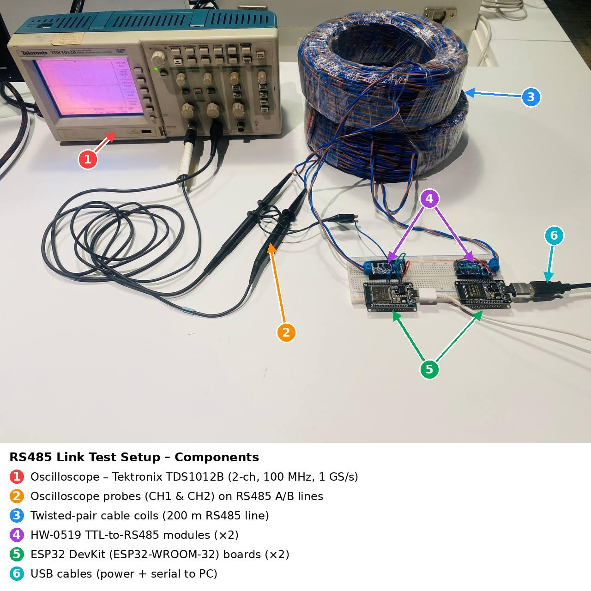
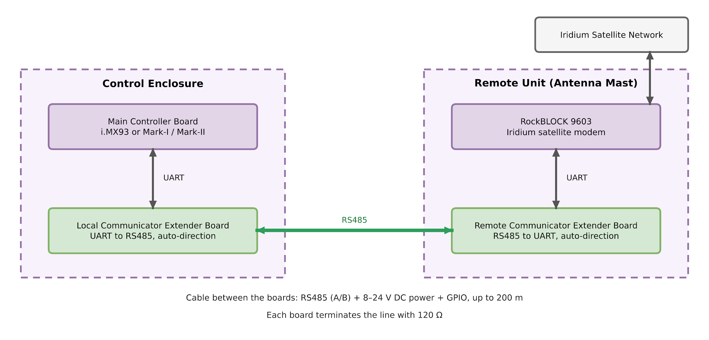
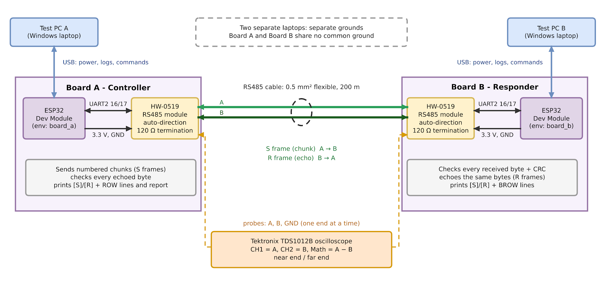
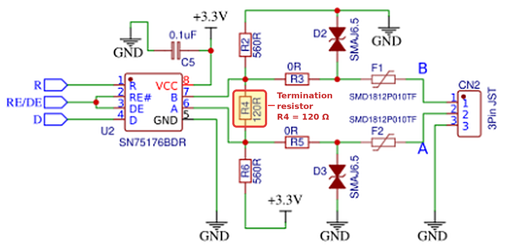
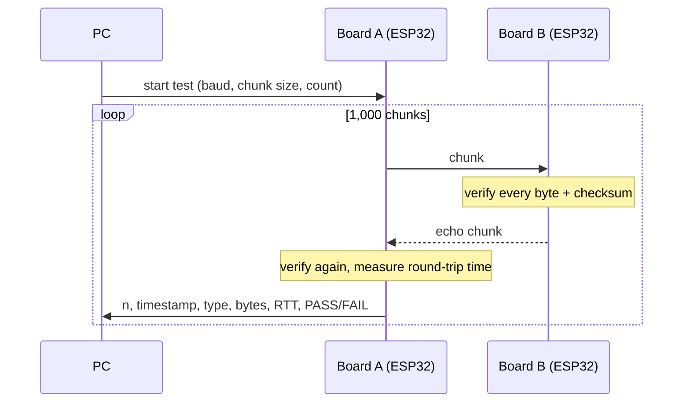
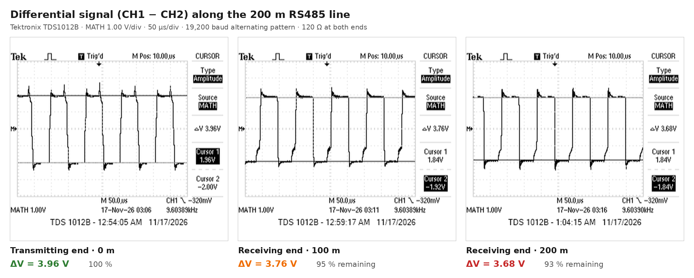
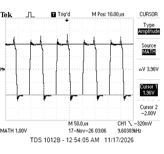
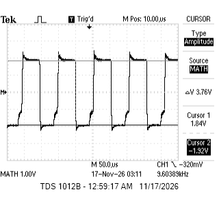
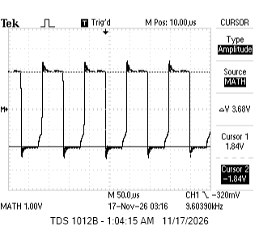
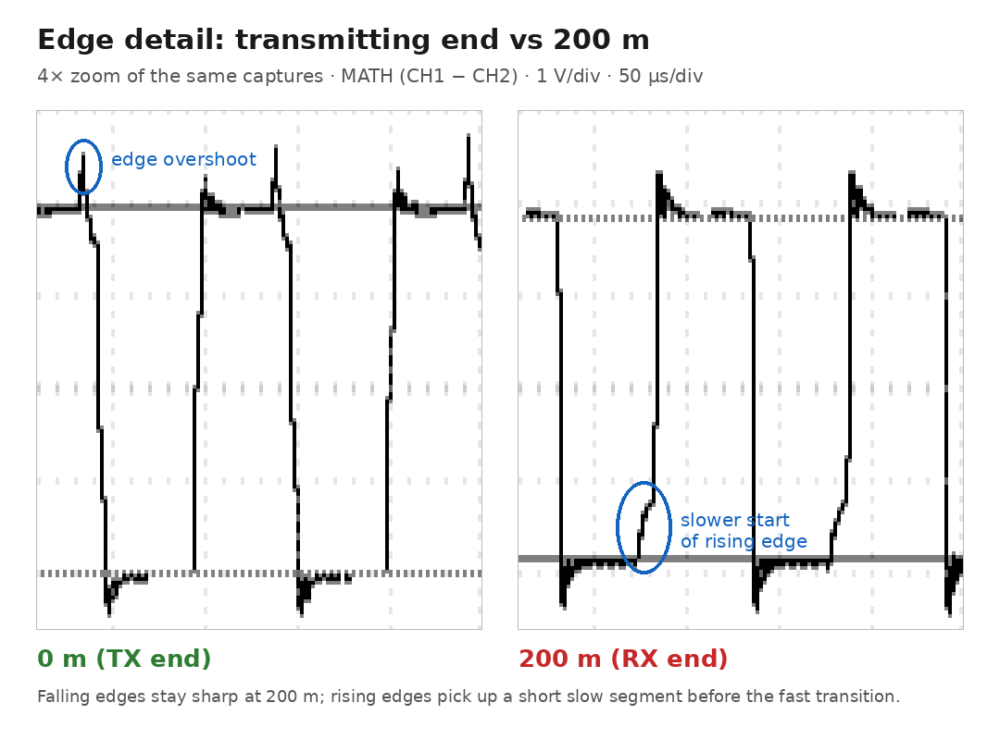

# RS485 Long-Distance Link — Performance & Signal Integrity Validation


Validating a 200 m RS485 link that carries the UART traffic of a **RockBLOCK 9603 Iridium satellite modem** from a remote antenna mast back to the main controller — proven both **digitally** (bit-exact echo tests) and **electrically** (differential waveform measurements at each end of the cable).

> 3,000 / 3,000 chunks passed · 12.68 million bytes verified in both directions · 0 bit errors · 93 % of the differential signal remaining after 200 m

<p align="center">
  
</p>

---

## Contents

- [Why this link exists](#why-this-link-exists)
- [Test bench](#test-bench)
- [Part 1 — Data integrity (echo tests)](#part-1--data-integrity-echo-tests)
- [Part 2 — Signal integrity on the wire](#part-2--signal-integrity-on-the-wire)
- [Cable selection](#cable-selection)
- [Key takeaways](#key-takeaways)
- [Repository layout](#repository-layout)

---

## Why this link exists

The satellite modem has to sit on an antenna mast with a clear view of the sky, up to 200 m away from the controller. A 3.3 V UART won't survive that distance, so each end gets a small **Communicator Extender Board** that converts UART ⇄ RS485 with automatic direction control. The same cable also carries 8–24 V DC power and GPIO.

<p align="center">
  
</p>

**What the link has to handle (RockBLOCK 9603):**

| Parameter | Value |
|---|---|
| Serial format | UART, 3.3 V, 8N1 |
| Default speed | 19,200 baud |
| Largest outgoing message (MO) | 340 bytes |
| Largest incoming message (MT) | 270 bytes |
| Largest single serial burst | **342 bytes** (MO + 2-byte checksum) |

Instead of burning satellite airtime, a test controller generates traffic in exactly the same formats and sizes as the modem.

---

## Test bench

| Item | Detail |
|---|---|
| Controllers | 2 × ESP32 DevKit (WROOM-32) — Board A sends & verifies, Board B verifies & echoes |
| Transceivers | 2 × HW-0519 TTL-to-RS485, auto-direction, 3.3 V supply |
| Cable | 200 m, 0.5 mm² twisted twin, flexible copper |
| Termination | 120 Ω across A–B at **both** ends |
| Instrumentation | Tektronix TDS1012B (2-ch, 100 MHz, 1 GS/s), P2220 probes at ×10, OpenChoice Desktop for waveform capture |
| Logging | USB serial to PC, per-chunk results logged to spreadsheet |

<p align="center">
  
  
</p>

---

## Part 1 — Data integrity (echo tests)

### Method

Board A sends numbered chunks over the cable. Board B checks every byte and checksum, then echoes the chunk back; Board A checks it again. A chunk only counts as **PASS** if it's correct in **both directions** — and there are **no retries**, so every single failure would show up in the log.



Each chunk opens with realistic modem traffic, rotating through five message types — **AT command**, **AT response** (`+SBDIX`), **ring alert** (`SBDRING`), **SBD MO** (340 B) and **SBD MT** (270 B) — then fills with random binary covering almost every byte value, so no bit pattern goes untested.

### Results @ 200 m

| | Test 1 — Real conditions | Test 2 — Speed stress | Test 3 — Speed + size stress |
|---|:---:|:---:|:---:|
| Baud rate | 19,200 | 115,200 (6×) | 115,200 (6×) |
| Chunk size | 342 B | 1,000 B (~3×) | 5,000 B (~15×) |
| Chunks | 1,000 | 1,000 | 1,000 |
| **PASS / FAIL** | **1,000 / 0** | **1,000 / 0** | **1,000 / 0** |
| Bytes verified (both ways) | 684,000 | 2,000,000 | 10,000,000 |
| Bit error rate (95 % conf.) | < 5.5 × 10⁻⁷ | < 1.9 × 10⁻⁷ | < 3.8 × 10⁻⁸ |
| Round trip — measured avg | 378.8 ms | 184.1 ms | 877.0 ms |
| Round trip — theoretical | 379.0 ms | 181.6 ms | 876.0 ms |
| Duration | 6.8 min | 3.6 min | 15.2 min (95.6 % link utilisation) |

Measured round-trip times sit within a couple of milliseconds of the theoretical serialisation time, so the 200 m cable and the auto-direction transceivers add no meaningful latency.

Since zero errors were observed, BER is reported as a **95 % confidence upper bound** (≈ 3 / bits-transferred) rather than claiming a BER of zero.

---

## Part 2 — Signal integrity on the wire

Passing data tells you the link works *today*. The waveform tells you how much margin is left for noise, longer runs or a worse cable.

### Measurement approach

- **CH1 on line A, CH2 on line B**, with the **math channel (CH1 − CH2)** reconstructing the true differential signal the receiver sees — rather than trusting either single-ended line on its own.
- Probes set to ×10 and **compensated against the scope's reference square wave** before every session, so edge shape and amplitude aren't distorted by the probes themselves.
- Board A transmits a continuous repeating pattern while Board B stays silent, so the line is driven from one end only and the TX/RX captures are directly comparable.
- Timebase at 50 µs/div, triggered on CH1; the 9.6 kHz fundamental on screen matches an alternating bit pattern at 19,200 baud (≈ 52 µs per bit).
- **Amplitude cursors** placed on the settled high and low levels — not on the edge overshoot — to read the peak-to-peak differential voltage (ΔV).
- RS485 module supply held at 3.3 V for all captures so the only variable is cable length.

### Captures

<p align="center">
  
</p>

| Transmitting end (0 m) | Receiving end (100 m) | Receiving end (200 m) |
|:---:|:---:|:---:|
|  |  |  |
| ΔV = **3.96 V** | ΔV = **3.76 V** | ΔV = **3.68 V** |

The amplitude barely moves over 200 m, and the frequency readout stays locked at 9.60 kHz in all three captures, so the pattern arrives intact with no missing or extra transitions.

### Edge detail

Zooming into the same captures shows how the edge shape changes along the cable, not just the amplitude:

<p align="center">
  
</p>

- **At the TX end** the transitions are fast, with a short overshoot spike that settles within a sample or two, and no ringing that lingers into the bit.
- **At 200 m** the falling edges are still sharp, but the rising edges start with a short, slower segment before the fast transition, the kind of softening expected from the extra capacitance and high-frequency loss of a long cable.
- Even with that softening, every transition finishes well inside the 52 µs bit at 19,200 baud, and the levels are flat and stable at the centre of each bit, which is where the UART samples.

### Attenuation

| Point | ΔV (A − B, pk-pk) | Drop | Signal remaining |
|---|:---:|:---:|:---:|
| TX end | 3.96 V | — | 100 % |
| RX @ 100 m | 3.76 V | 0.20 V | 95 % |
| RX @ 200 m | 3.68 V | 0.28 V | **93 %** |

At 200 m each logic level arrives at about **±1.84 V**. The RS485 receiver threshold is ±0.2 V, so that's roughly **9×** the standard minimum and about **3×** a deliberately conservative 0.6 V design margin chosen to cover real-world noise.

---

## Cable selection

The tested cable was compared against CAT6 and CAT6A for the final installation, which needs RS485 + power + GPIO in a single run. CAT6/CAT6A figures are calculated from conductor resistance, the measured 3.96 V drive level and the 120 Ω termination.

| | 0.5 mm² twisted twin (tested) | **CAT6** | CAT6A |
|---|:---:|:---:|:---:|
| Conductor | 0.5 mm² | 23 AWG | 22–23 AWG |
| Resistance / 100 m | ≈ 3.6 Ω | ≈ 6.6 Ω | ≈ 5.3–6.6 Ω |
| RX level after 200 m | 3.68 V (measured) | ≈ 3.25 V | ≈ 3.25–3.37 V |
| Margin vs 0.6 V design limit | ≈ 3× | ≈ 2.7× | ≈ 2.7–2.8× |
| Est. max length (voltage-drop limit) | ≈ 3,800 m | ≈ 2,100 m | ≈ 2,100–2,600 m |
| RS485 guideline @ 19.2k / 115.2k | 1,200 m / ≈ 850 m | 1,200 m / ≈ 850 m | 1,200 m / ≈ 850 m |
| Verdict | Suitable | **Recommended** | No added benefit |

**Recommendation:** CAT6 with solid pure-copper conductors (not CCA), with A and B on the **same twisted pair**. Its pairs reject common-mode noise better than the tested cable, and its 8 conductors fit RS485, power, ground and GPIO in one jacket — while still delivering ~2.7× the design margin at 200 m. Above the voltage-drop limit, the practical ceiling is the RS485 distance/data-rate guideline, not attenuation.

---

## Key takeaways

- **Zero errors across 12.68 M bytes** at the modem's real operating point and at 6× speed / 15× message size.
- **Timing matches theory** within ~2 ms — no hidden latency from the transceivers or cable.
- **Only 7 % signal loss over 200 m**, with clean, well-terminated edges and a large margin above the receiver threshold.
- The link has headroom far beyond what the RockBLOCK 9603 will ever ask of it.

**Skills exercised:** RS485 physical-layer design and termination · differential signal measurement and waveform analysis · test-plan design with statistically honest pass criteria · ESP32 firmware for automated echo testing and logging · cable characterisation and selection · technical reporting.

---

## Repository layout

```
rs485-long-distance-link/
├── README.md
├── docs/
│   └── RS485_Link_Performance_and_Signal_Integrity_Report.docx   # full test report
└── images/
    ├── system-overview.png          # end-to-end link architecture
    ├── test-bench.jpg               # annotated bench setup
    ├── echo-test-principle.png      # echo test flow
    ├── controller-rs485-wiring.png  # ESP32 ⇄ HW-0519 wiring
    ├── line-termination.png         # 120 Ω termination on the module
    ├── scope-comparison.png         # 0 m / 100 m / 200 m captures, labelled
    ├── scope-edge-detail.png        # zoomed transitions, 0 m vs 200 m
    ├── scope-tx-0m.png              # differential capture, TX end
    ├── scope-rx-100m.png            # differential capture, 100 m
    └── scope-rx-200m.png            # differential capture, 200 m
```

---

*Carried out during industrial training in the Embedded Engineering division at Zone24x7 (Pvt) Ltd, 2026.*
*Author: Shaman Karunaratne — [GitHub @0xshaman-eng](https://github.com/0xshaman-eng)*
